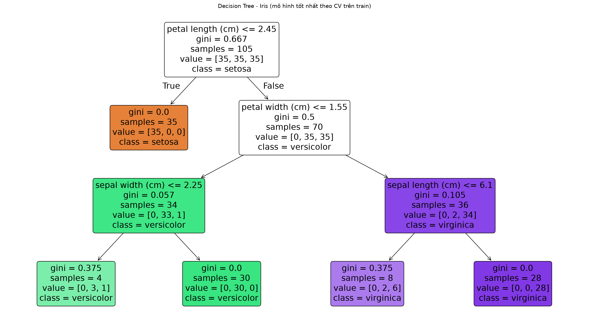
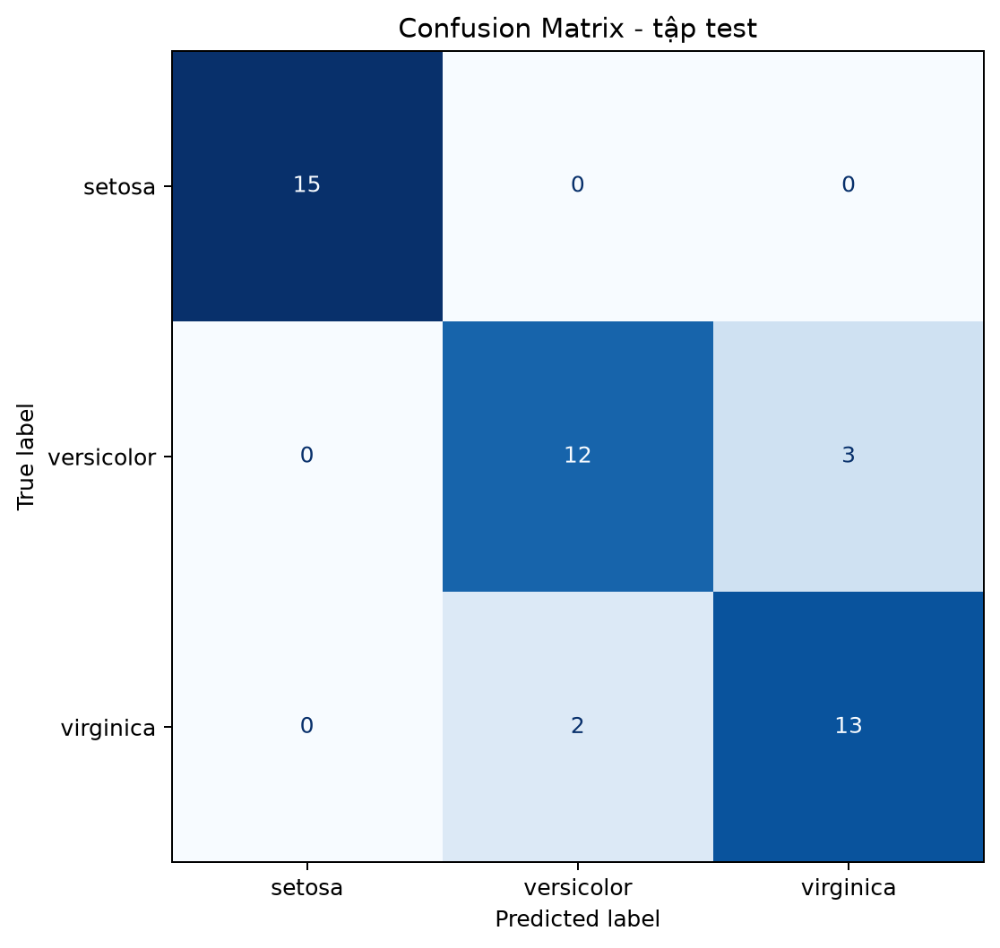
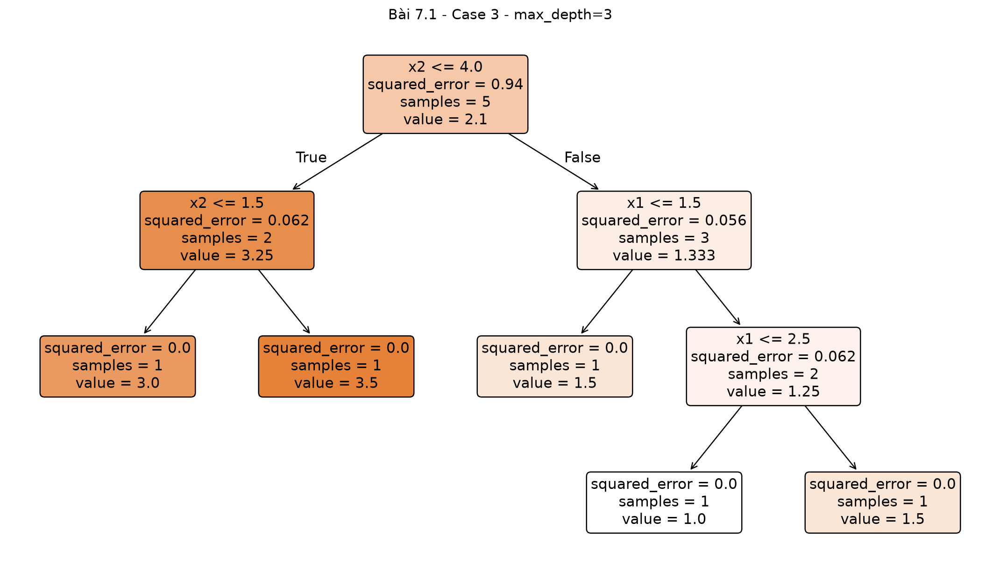
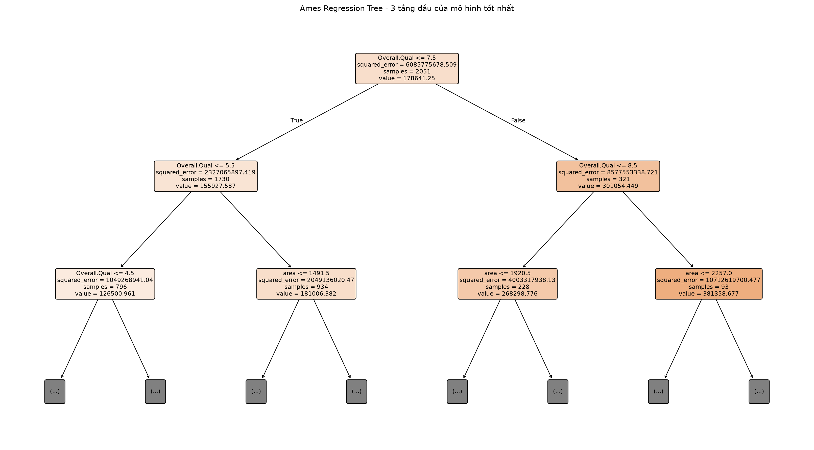
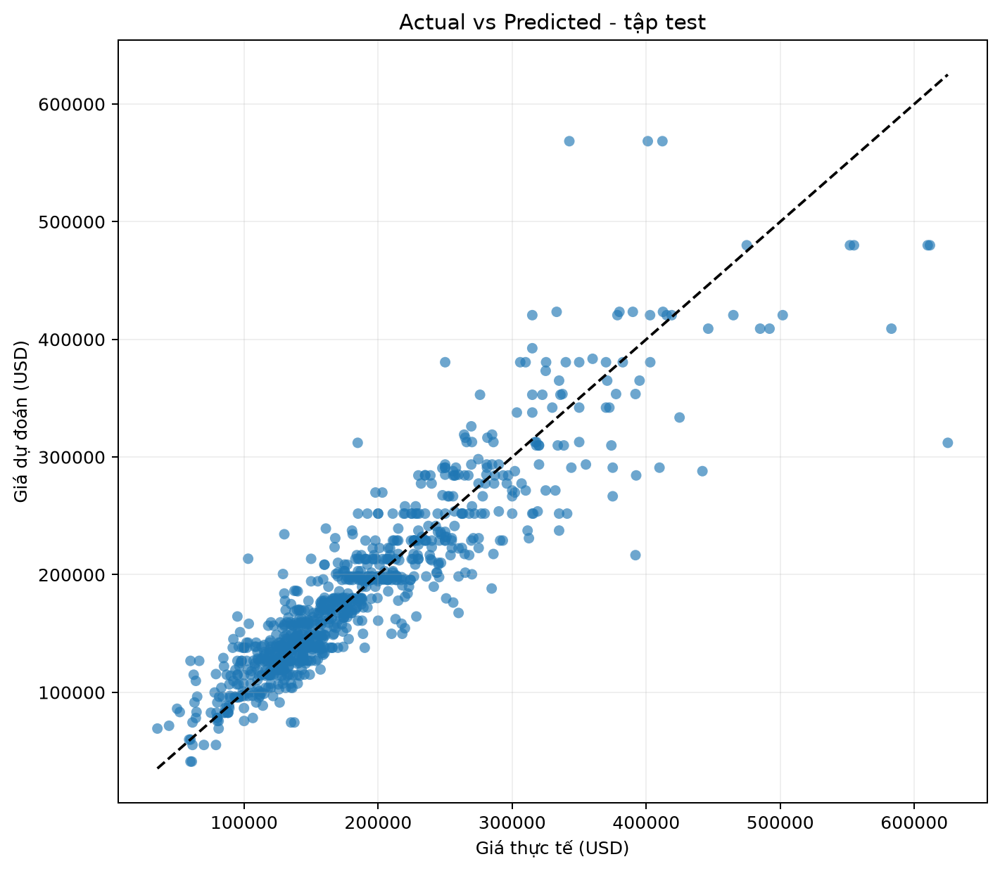

# Báo cáo Classification Tree và Regression Tree

## 1. Phạm vi và căn cứ

Project triển khai hai loại Decision Tree theo phạm vi được giao, nhưng không tuyên bố PDF xác nhận “chỉ có hai bài phải nộp”. Bằng chứng chi tiết nằm ở `assignment-evidence.md`.

- `AI-Ex-2027.pdf`, trang 18: bốn bài Decision Tree Regressor toy, `max_depth=3`.
- `AI-Ex-2027.pdf`, trang 19: Iris Classification bằng Decision Tree.
- `AI2027.pdf`, trang 372: Decision Tree dùng cho cả classification và regression.
- Body Fat và yêu cầu Orange cho Decision Tree không xuất hiện trong hai PDF.

## 2. Classification Tree - Iris

### Problem

Phân loại một mẫu hoa thành Setosa, Versicolor hoặc Virginica.

### Dataset, features và target

- Dataset: Iris từ `sklearn.datasets.load_iris()`.
- 150 mẫu, 4 feature, 3 lớp cân bằng; mỗi lớp 50 mẫu.
- Features: sepal length, sepal width, petal length, petal width.
- Target: species.
- Không có missing value. Có 1 dòng trùng khi xét cả feature và target; giữ nguyên để bảo toàn dataset chuẩn.

### Preprocessing và train/test split

Không impute, encode hay scale vì bốn feature đã là số và không thiếu. Dữ liệu được chia 70/30 với `random_state=42` và `stratify=y`:

- Train: 105 mẫu, mỗi lớp 35.
- Test: 45 mẫu, mỗi lớp 15.

Test set không tham gia tuning.

### Model và hyperparameters

Mô hình là `DecisionTreeClassifier(random_state=42)`. Grid search dùng Stratified 5-fold CV chỉ trên train, tối ưu macro-F1:

- `criterion`: `gini` hoặc `entropy` - cách đo độ không thuần khiết.
- `max_depth`: 2, 3, 4 hoặc không giới hạn - giới hạn số tầng.
- `min_samples_split`: 2, 5, 10 - số mẫu tối thiểu để tiếp tục chia một nút.
- `min_samples_leaf`: 1, 2, 4 - số mẫu tối thiểu trong một lá.

Cấu hình CV tốt nhất:

```text
criterion = gini
max_depth = 3
min_samples_split = 2
min_samples_leaf = 4
CV macro-F1 = 0.952332
```

### Metrics thật trên test

| Metric | Giá trị |
| --- | ---: |
| Accuracy | 0.888889 |
| Precision macro | 0.889881 |
| Recall macro | 0.888889 |
| F1 macro | 0.888765 |

Confusion Matrix:

| Actual \ Predicted | Setosa | Versicolor | Virginica |
| --- | ---: | ---: | ---: |
| Setosa | 15 | 0 | 0 |
| Versicolor | 0 | 12 | 3 |
| Virginica | 0 | 2 | 13 |





### Cách đọc cây

- **Điều kiện phân nhánh:** nếu điều kiện `feature <= threshold` đúng, đi sang trái; sai, đi sang phải.
- **gini:** mức độ trộn lớp; 0 nghĩa là nút thuần một lớp.
- **samples:** số mẫu train đến nút đó.
- **value:** số mẫu của từng lớp theo thứ tự `[setosa, versicolor, virginica]`.
- **class:** lớp chiếm đa số, cũng là dự đoán tại nút/lá.

Nút gốc dùng `petal length <= 2.45`. Nhánh đúng tách toàn bộ 35 Setosa với Gini bằng 0. Sai số test chỉ nằm giữa Versicolor và Virginica, phù hợp với việc hai lớp này có vùng feature gần nhau hơn.

### Hạn chế và kết luận

Tập test chỉ có 45 mẫu nên một vài dự đoán thay đổi sẽ làm metric dao động rõ. Cấu hình được chọn bằng CV trên train, không tối ưu lại theo test. Mô hình đạt 40/45 dự đoán đúng và giải thích trực quan được bằng các ngưỡng feature.

## 3. Regression Tree - bài 7.1 đúng theo PDF

### Problem và dataset

`AI-Ex-2027.pdf`, trang 18 yêu cầu tính và vẽ `Decision Tree Regressor with max depth = 3` cho bốn bộ toy:

1. `X={2,1,3,5}`, `y={1.5,2.5,3,2}`.
2. `X={2.5,1.5,2,3,3.5}`, `y={1,2.5,3,2.5,1.5}`.
3. `X={(2,5),(1,5),(2,0),(0,3),(3,5)}`, `y={1,1.5,3,3.5,1.5}`.
4. `X={(1,2,3),(0,1,2),(2,4,1)}`, `y={1,1.5,2}`.

Target đều là số. Mỗi case dùng `DecisionTreeRegressor(max_depth=3, random_state=42)` và fit toàn bộ dữ liệu để vẽ đúng bài.

### Kết quả

| Case | Mẫu | Feature | Độ sâu thực | Số lá | Train MAE | Train RMSE | Train R² |
| --- | ---: | ---: | ---: | ---: | ---: | ---: | ---: |
| 1 | 4 | 1 | 2 | 4 | 0 | 0 | 1 |
| 2 | 5 | 1 | 3 | 5 | 0 | 0 | 1 |
| 3 | 5 | 2 | 3 | 5 | 0 | 0 | 1 |
| 4 | 3 | 3 | 2 | 3 | 0 | 0 | 1 |



Các metric bằng 1 chỉ cho biết cây đã nhớ toàn bộ 3-5 mẫu train. Tài liệu không yêu cầu split; với số mẫu quá nhỏ, holdout metric không ổn định và có thể không xác định. Vì vậy không dùng kết quả này để tuyên bố mô hình tổng quát hóa tốt.

## 4. Regression Tree - đánh giá mở rộng trên Ames

### Vai trò dataset

Body Fat không có trong tài liệu/workspace. Ames là dữ liệu có sẵn, target `price` dạng số và House Price được mô tả ở `AI-Ex-2027.pdf`, trang 16-17 cho Linear Regression. Phần này đổi thuật toán sang Decision Tree để có một thí nghiệm hồi quy đủ lớn; đây là phần mở rộng, không phải dataset bài 7.1.

### Dataset, features và target

- Raw: 2.930 dòng, 82 cột; không có duplicate toàn dòng.
- Target: `price`, không thiếu/không hợp lệ.
- 19 feature được chọn theo nhóm diện tích, chất lượng, tuổi nhà, phòng, garage, zoning, neighborhood, kiểu nhà, chất lượng bếp và điều kiện bán.
- Missing trong feature đã chọn: `Garage.Cars` 1 dòng, `Garage.Area` 1 dòng.
- Outlier được đếm bằng IQR để audit, nhưng không lọc theo toàn dataset và không dùng để thay đổi model.

### Preprocessing

- Numeric: `SimpleImputer(strategy="median")`.
- Categorical: `SimpleImputer(strategy="most_frequent")` rồi `OneHotEncoder(handle_unknown="ignore")`.
- Toàn bộ preprocessing nằm trong `Pipeline` và được fit trong mỗi fold train.
- Không dùng `StandardScaler` vì Decision Tree không phụ thuộc khoảng cách hay độ lớn thang đo.
- `Order`, `PID` và target `price` không nằm trong feature, tránh ID/target leakage.

### Train/test split và model

- Split 70/30, `random_state=42`.
- Train: 2.051 mẫu; test: 879 mẫu.
- Model: `DecisionTreeRegressor(random_state=42, criterion="squared_error")`.
- Grid search 5-fold CV trên train thử `max_depth={4,6,8,10,None}`, `min_samples_split={2,10,20}`, `min_samples_leaf={1,5,10}`.

Cấu hình tốt nhất:

```text
max_depth = 10
min_samples_split = 2
min_samples_leaf = 5
CV RMSE = 34,949.66 USD
```

### Metrics thật

| Tập | MAE (USD) | RMSE (USD) | R² |
| --- | ---: | ---: | ---: |
| Train - chỉ tham khảo | 14,240.08 | 23,122.74 | 0.912146 |
| Test - kết quả chính | 22,691.65 | 34,913.24 | 0.826596 |





### Phân tích kết quả

- MAE cho biết sai lệch tuyệt đối trung bình khoảng 22,692 USD trên test.
- RMSE lớn hơn MAE, cho thấy một số căn nhà có sai số lớn; biểu đồ cũng thể hiện các điểm giá cao lệch xa đường lý tưởng.
- R² test khoảng 0.8266 nghĩa là mô hình giải thích khoảng 82.66% biến thiên giá trong test split này.
- Chênh lệch train/test cho thấy cây vẫn fit train tốt hơn test. Giới hạn độ sâu và kích thước lá đã được chọn bằng CV để giảm overfitting, nhưng không xóa hoàn toàn khoảng cách này.

### Hạn chế và kết luận

- Ames là dữ liệu nhà ở Mỹ giai đoạn cũ, không đại diện thị trường Việt Nam.
- Đây không phải Body Fat và không phải dataset Regression Tree được mục 7.1 chỉ định.
- Một cây đơn dễ thay đổi khi dữ liệu/split thay đổi; Random Forest có thể ổn định hơn nhưng nằm ngoài phạm vi hai bài hiện tại.
- Kết quả test không được dùng lại để tuning.

## 5. So sánh hai loại cây

| Nội dung | Classification Tree | Regression Tree |
| --- | --- | --- |
| Target | Category/lớp | Số liên tục |
| Mục tiêu chia | Tăng độ thuần lớp | Giảm sai số trong các vùng |
| Tiêu chí điển hình | Gini, Entropy | Squared error/MSE |
| Giá trị tại lá | Lớp đa số/xác suất lớp | Trung bình target trong lá |
| Metric | Accuracy, Precision, Recall, F1, Confusion Matrix | MAE, RMSE, R² |
| Orange | Có thể dùng Confusion Matrix | Không dùng Confusion Matrix |

## 6. Orange

Ba hướng dẫn thực hành và cách kiểm tra được mô tả tại `orange-workflows.md`; project phát hành hai file `.ows` đã round-trip và chạy end-to-end bằng `Orange.canvas.run` của Orange 3.40.0 cho Iris và Ames. Cả hai runner trả exit code `0`, không có widget Error. Nhánh đúng phải dùng Tree **Learner** cho Test & Score, Tree **Model** cho Predictions/Tree Viewer, và chỉ workflow classification mới nối Test & Score vào Confusion Matrix. Bốn toy case được hướng dẫn mở từng CSV vì dữ liệu quá ít để holdout evaluation đáng tin cậy.

Sau migration ngày 2026-07-10, workspace thực thi là `D:\courses\Artificial-Intelligence`. Hai `.ows` được tái tạo phần cache đường dẫn bằng Orange 3.40.0 nhưng giữ nguyên relative path, node/link và setting; kiểm tra CLI hậu migration tiếp tục cho exit code `0` ở cả hai workflow. OLD_ROOT `D:\courses\Trí tuệ nhân tạo` chỉ được giữ như lịch sử lỗi Unicode. CLI xác nhận thực thi kỹ thuật; GUI chỉ còn dùng để kiểm tra bố cục và chụp ảnh, không được tuyên bố tự động là đã pass.

## 7. Kết luận chung

Project đã chạy đúng hai loại Decision Tree, giữ test độc lập và lưu toàn bộ metric/hình từ lần chạy thật. Iris là dataset được tài liệu xác nhận cho Classification Tree; Regression Tree toy bám đúng mục 7.1; Ames chỉ là phần mở rộng có gắn nhãn rõ. Không có cơ sở file để kết luận Body Fat, Orange hay một “bài thứ ba” là yêu cầu bắt buộc.
