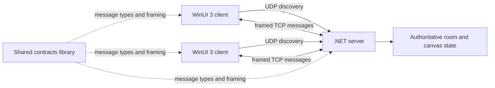

# Collaborative Whiteboard LAN

[](https://github.com/qivarnq3g/collaborative-whiteboard-lan/actions/workflows/ci.yml)
[](LICENSE)
[](https://dotnet.microsoft.com/)
[](https://www.microsoft.com/windows)

A real-time collaborative whiteboard for local area networks. The Windows client discovers rooms over UDP and synchronizes drawing, chat, layers, and room state through a framed TCP protocol.


## Features

- Automatic room discovery through UDP broadcast
- Real-time drawing synchronization over TCP
- Pencil, line, rectangle, ellipse, and eraser tools
- Shared layers with visibility, locking, ordering, and opacity controls
- Per-user undo and redo
- Built-in room chat and live participant list
- Password-protected rooms and first-user ownership
- Host controls for locking rooms, clearing the canvas, and managing users
- Automatic reconnection with bounded exponential backoff
- Length-prefixed JSON messages with protocol-version checks and input limits

## Requirements

- Windows 10 build 19041 or later
- [.NET 10 SDK](https://dotnet.microsoft.com/download/dotnet/10.0)
- Windows App SDK runtime required by the WinUI 3 client
- Devices connected to the same LAN, with local firewall access for the configured TCP and UDP ports

## Quick start

Clone and restore the solution:

```powershell
git clone https://github.com/qivarnq3g/collaborative-whiteboard-lan.git
cd collaborative-whiteboard-lan
dotnet restore .\066206005044_BTL_CollaborativeWhiteboardLAN.slnx
```

Start the server:

```powershell
dotnet run --project .\066206005044_BTL_WhiteboardServer -- `
  --room "My Whiteboard" `
  --password "change-me"
```

In a second terminal, start one or more clients:

```powershell
dotnet run --project .\066206005044_BTL_WhiteboardClient
```

Select **Refresh**, choose the discovered room, enter the room password when required, and connect.

### Server options

| Option | Default | Purpose |
|---|---:|---|
| `--tcp` | `49000` | TCP session port |
| `--discovery` | `49001` | UDP discovery port |
| `--room` | `BTL-LAN-ROOM` | Room name advertised to clients |
| `--password` | none | Optional room password |

If discovery is blocked, allow inbound UDP on port `49001` and TCP on port `49000`, or substitute the custom ports you selected.

## Architecture



| Project | Responsibility |
|---|---|
| `066206005044_BTL_WhiteboardClient` | WinUI 3 interface, drawing tools, discovery, and session management |
| `066206005044_BTL_WhiteboardServer` | Room authority, TCP sessions, UDP discovery, history, and moderation |
| `066206005044_BTL_WhiteboardContracts` | Protocol envelopes, payloads, framing, constants, and JSON settings |

The server is authoritative: it validates client messages, owns room state, and broadcasts accepted state changes. New clients receive room state before canvas and participant snapshots so the UI starts from a consistent state.

## Security scope

This project is designed for trusted local networks and learning purposes. Traffic is not encrypted, the protocol does not provide strong identity authentication, and room passwords must not be treated as high-value credentials. Do not expose the ports directly to the public internet. See [SECURITY.md](SECURITY.md) for vulnerability reporting and supported versions.

## Contributing

Bug reports and focused pull requests are welcome. Read [CONTRIBUTING.md](CONTRIBUTING.md) and follow the [Code of Conduct](CODE_OF_CONDUCT.md) before contributing.

## License

Distributed under the [MIT License](LICENSE).
